# Diagrama entidad-relación de COCHASABOR

**Estado:** modelo conceptual revisado; el usuario confirmó que importó el esquema físico y los datos demo desde `database/cochasabor.sql`. Para autenticación se añadió `user_sessions`; falta ejecutar únicamente su bloque `CREATE TABLE IF NOT EXISTS` en la base ya importada. Este documento conserva la vista ER; el archivo SQL es la definición física ejecutable.  
**Base:** decisiones acordadas con el usuario; las reglas que faltan se enumeran al final para no fijarlas por suposición.

## Diagrama

```mermaid
erDiagram
  USERS ||--o{ PLACES : aporta
  USERS ||--o{ REVIEWS : escribe
  USERS o|--o{ REVIEW_HISTORY : modifica
  PLACES ||--o{ REVIEWS : recibe
  REVIEWS ||--o{ REVIEW_HISTORY : conserva_cambios
  PLACES ||--o{ PLACE_CATEGORIES : clasifica
  CATEGORIES ||--o{ PLACE_CATEGORIES : incluye
  USERS ||--o{ CATEGORY_SUGGESTIONS : propone
  USERS o|--o{ CATEGORY_SUGGESTIONS : revisa
  PLACES ||--o{ PLACE_CONTACTS : tiene
  PLACES ||--o{ PLACE_OPENING_HOURS : publica
  PLACES ||--o{ MEDIA : galeria
  REVIEWS ||--o| MEDIA : foto_opcional
  USERS ||--o{ FAVORITES : guarda
  PLACES ||--o{ FAVORITES : recibe
  USERS ||--o{ PLACE_REPORTS : reporta
  PLACES ||--o{ PLACE_REPORTS : recibe
  REPORT_REASONS ||--o{ REPORT_REASON_TARGETS : habilita
  PLACES ||--o{ PLACE_MODERATION_CASES : se_revisa
  USERS o|--o{ PLACE_MODERATION_CASES : inicia
  USERS o|--o{ PLACE_MODERATION_CASES : resuelve
  PLACE_MODERATION_CASES o|--o{ PLACE_REPORTS : agrupa
  USERS ||--o{ REVIEW_REPORTS : reporta
  REVIEWS ||--o{ REVIEW_REPORTS : recibe
  REPORT_REASON_TARGETS ||--o{ PLACE_REPORTS : permite
  REPORT_REASON_TARGETS ||--o{ REVIEW_REPORTS : permite
  REVIEW_MODERATION_CASES o|--o{ REVIEW_REPORTS : agrupa
  REVIEWS ||--o{ REVIEW_MODERATION_CASES : se_evalua
  USERS o|--o{ REVIEW_MODERATION_CASES : resuelve
  REVIEW_MODERATION_CASES ||--o{ REVIEW_APPEALS : recibe
  USERS ||--o{ REVIEW_APPEALS : presenta
  USERS ||--o{ OWNER_CLAIMS : solicita
  PLACES ||--o{ OWNER_CLAIMS : se_reclama
  USERS o|--o{ OWNER_CLAIMS : revisa
  USERS ||--o{ USER_ROLE_ASSIGNMENTS : recibe
  ROLES ||--o{ USER_ROLE_ASSIGNMENTS : asigna
  USERS o|--o{ USER_ROLE_ASSIGNMENTS : concede
  USERS ||--o{ USER_SESSIONS : mantiene

  USERS {
    id user_id PK
    string email_optional UK
    string display_name
    string password_hash_optional
    datetime created_at
    datetime anonymized_at
  }
  ROLES {
    id role_id PK
    string code UK
    string description
  }
  USER_ROLE_ASSIGNMENTS {
    id user_id PK,FK
    id role_id PK,FK
    id granted_by_user_id_optional FK
    datetime granted_at
  }
  USER_SESSIONS {
    string session_id PK
    id user_id FK
    datetime expires_at
    datetime created_at
    datetime last_seen_at
    datetime revoked_at_optional
  }
  PLACES {
    id place_id PK
    string slug UK
    string name
    string description
    string zone
    decimal latitude_optional
    decimal longitude_optional
    string address_optional
    string price_estimate_optional
    string visibility_status
    boolean is_demo
    id created_by_user_id FK
    datetime created_at
    datetime updated_at
  }
  CATEGORIES {
    id category_id PK
    string slug UK
    string name
    boolean is_active
  }
  PLACE_CATEGORIES {
    id place_id PK, FK
    id category_id PK, FK
  }
  CATEGORY_SUGGESTIONS {
    id suggestion_id PK
    id proposed_by_user_id FK
    string proposed_name
    string status
    id reviewed_by_user_id_optional FK
    datetime created_at
    datetime reviewed_at
  }
  PLACE_CONTACTS {
    id contact_id PK
    id place_id FK
    string contact_type
    string value
  }
  PLACE_OPENING_HOURS {
    id opening_hour_id PK
    id place_id FK
    int weekday "1=lunes ... 7=domingo"
    time opens_at_optional
    time closes_at_optional
    boolean closes_next_day
    boolean is_closed
  }
  MEDIA {
    id media_id PK
    id place_id_optional FK
    id review_id_optional FK, UK
    string media_type
    string storage_key UK
    string alt_text
    int position
    boolean is_cover
    datetime created_at
  }
  REVIEWS {
    id review_id PK
    id place_id FK
    id user_id FK
    int rating
    string comment
    string visibility_status
    int version_number
    datetime created_at
    datetime updated_at
    datetime hidden_at_optional
  }
  REVIEW_HISTORY {
    id review_history_id PK
    id review_id FK
    int version_number
    string change_type
    int rating
    string comment
    string visibility_status
    id changed_by_user_id_optional FK
    datetime changed_at
  }
  FAVORITES {
    id user_id PK, FK
    id place_id PK, FK
    datetime created_at
  }
  REPORT_REASONS {
    id reason_id PK
    string code
    string label
    boolean is_active
  }
  REPORT_REASON_TARGETS {
    id reason_id PK, FK
    string target_type PK "PLACE o REVIEW"
  }
  PLACE_REPORTS {
    id report_id PK
    id place_id FK
    id reporter_user_id FK
    id reason_id FK
    string target_type "CHECK PLACE; FK compuesto"
    id moderation_case_id_optional FK
    string details_optional
    string status "PENDING, WITHDRAWN o RESOLVED"
    datetime created_at
    datetime closed_at_optional
  }
  PLACE_MODERATION_CASES {
    id case_id PK
    id place_id FK
    id opened_by_user_id_optional FK
    id resolved_by_user_id_optional FK
    string trigger_type
    int threshold_used_optional
    string status
    string decision_optional
    datetime opened_at
    datetime resolved_at_optional
  }
  REVIEW_REPORTS {
    id report_id PK
    id review_id FK
    id reporter_user_id FK
    id reason_id FK
    string target_type "CHECK REVIEW; FK compuesto"
    id moderation_case_id_optional FK
    string details_optional
    string status "PENDING, WITHDRAWN o RESOLVED"
    datetime created_at
    datetime closed_at_optional
  }
  REVIEW_MODERATION_CASES {
    id case_id PK
    id review_id FK
    string status
    string ai_result_optional
    string ai_model_version_optional
    string policy_version_optional
    datetime ai_evaluated_at_optional
    id resolved_by_user_id_optional FK
    string team_decision_optional
    datetime opened_at
    datetime resolved_at_optional
  }
  REVIEW_APPEALS {
    id appeal_id PK
    id moderation_case_id FK
    id appellant_user_id FK
    string reason
    string status
    id resolved_by_user_id_optional FK
    datetime created_at
    datetime resolved_at_optional
  }
  OWNER_CLAIMS {
    id claim_id PK
    id place_id FK
    id claimant_user_id FK
    string status
    string evidence_reference_optional
    id reviewed_by_user_id_optional FK
    datetime submitted_at
    datetime reviewed_at_optional
  }
```

## Reglas acordadas que afectan el modelo

- Una cuenta puede sugerir lugares y crear favoritos y reseñas. Cada lugar puede tener varias categorías.
- Un lugar nuevo se publica directamente. La cuenta que lo aporta indica si reclama ser propietaria; el reclamo se verifica aparte por el equipo. Mientras no se apruebe, el lugar sigue visible sin distintivo de propietario verificado.
- Se requieren nombre, categoría, ubicación en el mapa y descripción breve. Dirección, contacto, redes, horario, precio e imágenes son opcionales. Un lugar puede tener una galería; una reseña puede adjuntar como máximo una foto.
- El equipo administra las categorías; los usuarios pueden proponer nuevas categorías.
- Cada usuario escribe como máximo una reseña por lugar. Puede editarla y ocultarla; se conserva el registro. Una infracción clara detectada por IA oculta la reseña. Si el resultado es dudoso o hay apelación, revisa el equipo.
- Cada edición o cambio de visibilidad de una reseña conserva una instantánea en `REVIEW_HISTORY` para mantener las versiones anteriores. `version_number` es secuencial por reseña; `change_type` identifica edición, ocultamiento, restauración u otro cambio. `changed_by_user_id` puede ser nulo cuando el cambio sea automático.
- Cada cuenta tiene como máximo un reporte activo por lugar y por reseña. Activo significa pendiente y no retirado: al retirar el reporte pasa a `WITHDRAWN`; cuando se resuelve su caso pasa a `RESOLVED`. Ambos estados dejan de bloquear un reporte posterior de esa cuenta sobre el mismo objeto. Los reportes de lugares cuentan por igual; al alcanzar un umbral configurable, el lugar se oculta temporalmente y se crea una revisión para el equipo. Un usuario confiable puede ocultarlo temporalmente directamente. El equipo decide restaurarlo o mantenerlo oculto.
- Cada motivo declara los tipos de objeto a los que se aplica en `REPORT_REASON_TARGETS`. Un motivo puede habilitarse para lugares, reseñas o ambos; las claves foráneas compuestas y las restricciones de tipo impiden reportar un objeto con un motivo incompatible.
- El primer reporte de una reseña abre una evaluación de IA; los reportes posteriores se adjuntan a esa revisión en vez de iniciar evaluaciones duplicadas. El resultado, versión del modelo y versión de las reglas se registran cuando estén disponibles.
- Los usuarios confiables y el equipo son cuentas comunes con permisos adicionales asignados; no son tipos de cuenta públicos distintos.
- Al eliminar una cuenta se anonimiza su identidad, conservando reseñas e historial relacionados.

## Restricciones a aplicar al implementar la base

- `REVIEWS`: `UNIQUE(user_id, place_id)` y `CHECK(rating BETWEEN 1 AND 5)`.
- `PLACE_CATEGORIES` y `FAVORITES`: clave primaria compuesta por sus dos referencias.
- Todo lugar debe tener al menos una categoría antes de confirmar su creación. MySQL no ofrece constraint triggers diferidos; el backend deberá insertar el lugar y sus categorías en una transacción y comprobar la asociación antes de confirmar.
- Los lugares reales requieren latitud y longitud. Solo las fichas marcadas `is_demo` pueden omitir coordenadas, para no inventar ubicaciones en las semillas de demostración.
- `PLACE_OPENING_HOURS.weekday` es el día de la semana, no una indicación de “día laboral”: usar ISO 1=lunes hasta 7=domingo y una restricción `CHECK (weekday BETWEEN 1 AND 7)`. Una fila representa un intervalo; se permiten varias filas por día para horarios partidos. Si `is_closed` es verdadero, las horas quedan nulas y `closes_next_day` es falso; si es falso, ambas horas son obligatorias. `closes_next_day` indica que el intervalo cruza la medianoche: en ese caso la hora de cierre debe ser menor que la de apertura; de lo contrario, la apertura debe ser menor que el cierre.
- `REVIEW_HISTORY`: clave única `(review_id, version_number)`; sus instantáneas se conservan al anonimizar la cuenta. Registrar el cambio dentro de la misma transacción que actualiza la reseña.
- Reportes: índice único parcial para impedir más de un reporte activo por persona y objeto. Los reportes retirados o cerrados se conservan como historial.
- `PLACE_REPORTS` solo admite `target_type='PLACE'` y `REVIEW_REPORTS` solo `target_type='REVIEW'`; cada `(reason_id, target_type)` debe existir en `REPORT_REASON_TARGETS`. El índice único parcial aplica a reportes `PENDING`; resolver un caso actualiza los reportes asociados a `RESOLVED`, y retirar uno lo actualiza a `WITHDRAWN`, registrando `closed_at`.
- `MEDIA`: exactamente uno entre `place_id` y `review_id` debe tener valor; un medio de reseña debe ser imagen y `review_id` debe ser único. Los archivos se almacenan fuera de la base y aquí se guarda su referencia. La portada solo aplica a medios de lugar.
- `PLACE_MODERATION_CASES`: como máximo un caso abierto por lugar. `threshold_used` registra el umbral que disparó el caso; queda vacío si un usuario confiable lo inició directamente.
- `REVIEW_MODERATION_CASES`: como máximo un caso abierto por reseña. Cada apelación apunta al caso que impugna; el límite de apelaciones por persona/decisión queda pendiente.
- La media de calificación y el número de reseñas se calculan; no se guardan como valores editables en `PLACES`.
- No se impone unicidad al nombre del lugar: sucursales o sitios distintos pueden compartir nombre. La detección de coincidencias por nombre/ubicación requiere una regla y una decisión de revisión.
- Las relaciones con `USERS` se conservan al anonimizar; se eliminan o sustituyen los datos identificativos conforme a la política que se defina.

## Decisiones todavía por definir

1. Valor del umbral de reportes de lugar, plazo para contar reportes y si el equipo lo configura. El modelo lo deja como parámetro y conserva el valor aplicado en cada caso.
2. Cómo se detecta y resuelve un lugar duplicado; qué ocurre con reseñas y favoritos si dos registros se consolidan.
3. Qué pruebas acepta el equipo para reclamar un lugar y si puede existir más de un propietario verificado por lugar.
4. Catálogo final de motivos de reporte; la tabla puente permite asignar cada motivo a lugares, reseñas o ambos y la base rechazará combinaciones incompatibles. También quedan pendientes las condiciones de los términos, el proveedor de IA y el tratamiento de errores de evaluación.
5. Detalle de horarios especiales, límites de longitud/tamaño, precio y formatos de contacto. Los campos enumerados son conceptuales y no establecen todavía formatos técnicos.
6. Retención y acceso a evidencias privadas de reclamos de propietario.

Este documento describe el modelo conceptual. La definición física inicial está consolidada en `database/cochasabor.sql`; este archivo por sí solo no crea tablas, API, reglas de permisos de aplicación ni servicios de IA.
