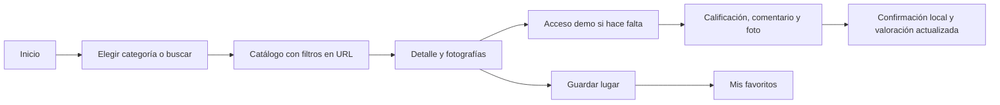

# COCHASABOR · Requisitos y alcance

Fecha: 13 de octubre de 2026. Referencia de desarrollo: [AGENTS.md](../AGENTS.md). Esta matriz resume los requisitos de producto registrados en las instrucciones del proyecto; no afirma una nueva lectura independiente del PDF.

## Alcance autorizado

El frontend Angular 22 de demostración y la base MariaDB están construidos. El alcance actual es integrar Angular con el backend Node.js/Express para lectura pública, cuentas, reseñas y favoritos. El chatbot y el despliegue quedan para etapas posteriores. Los datos JSON y el almacenamiento del navegador siguen siendo solo la demostración del frontend hasta completar el adaptador HTTP.

| Requisito de la guía                                           | Origen indicado | Evidencia esperada en el frontend                                      | Integración posterior                              |
| -------------------------------------------------------------- | --------------- | ---------------------------------------------------------------------- | -------------------------------------------------- |
| Directorio centrado en Cochabamba                              | PDF pp. 2–4     | 8 fichas ficticias identificadas, zonas y textos en español            | Sustituir fichas por información verificada        |
| Inicio, listado, detalle y formulario de reseña                | PDF pp. 3–4     | Rutas navegables y formularios funcionales                             | Conectar repositorios HTTP                         |
| Exploración y filtros por categoría                            | PDF pp. 2 y 4   | 4 categorías, búsqueda, orden y paginación en URL                      | Consultas paginadas del servidor                   |
| Base de datos relacional                                       | PDF pp. 2–3     | Diagrama ER y script único MariaDB/MySQL con esquema y datos mínimos | Ejecutar en XAMPP/phpMyAdmin y verificar integridad |
| Lugares, categorías, usuarios, reseñas, multimedia y favoritos | PDF p. 3        | Modelos tipados y relaciones de fixtures validadas                     | Restricciones relacionales y permisos              |
| Tarjetas, galería, estrellas y navegación reutilizable         | PDF pp. 3–4     | Componentes compartidos entre vistas                                   | Sin dependencia de backend                         |
| Fotografías, galería y videos cortos                           | PDF pp. 3–4     | WebP locales, galería por botones, clip ilustrativo sin autoplay       | Fotografías y videos verificados de lugares        |
| Calificar y adjuntar fotografía                                | PDF p. 4        | Formulario, vista previa, guardado local y actualización de valoración | Multipart, validación real y almacenamiento seguro |
| Formularios accesibles y errores comprensibles                 | PDF p. 4        | Etiquetas, radios nativos, foco y mensajes por campo                   | Validación equivalente en API                      |
| Navegación y usabilidad                                        | PDF p. 4        | Pruebas de rutas y revisión de vistas                                  | Recorridos contra API                              |

## Decisiones y ampliaciones

- Decisiones: standalone, strict y strictTemplates, Signals, formularios reactivos, SCSS, carga diferida, SPA zoneless.
- Datos: una fuente en `public/data/directory.json`, usuarios ficticios, reseñas semilla identificadas como demo. Un lugar sin reseñas y categorías múltiples para probar estados y relaciones.
- Acceso: perfiles locales de demostración, sin correo, contraseña o tokens. Usar el mismo nombre recupera el mismo perfil; esto no es autenticación.
- Reseñas: una por perfil/lugar, rating entero 1–5, comentario de 10–1000 caracteres sin espacios periféricos, foto opcional JPG/PNG/WebP de hasta 5 MB.
- Favoritos: colección local por perfil, disponible en varias pantallas y tras recarga.
- Ampliaciones excluidas: reservas, pagos, chat, mapas interactivos, recomendaciones con IA, comparador especializado y panel administrativo.

## Recorrido

